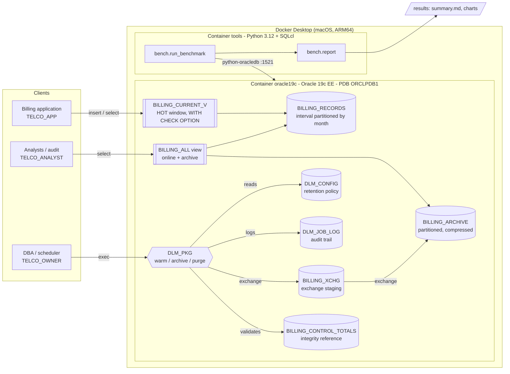
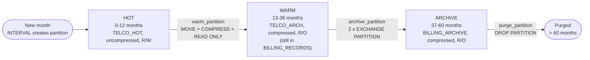
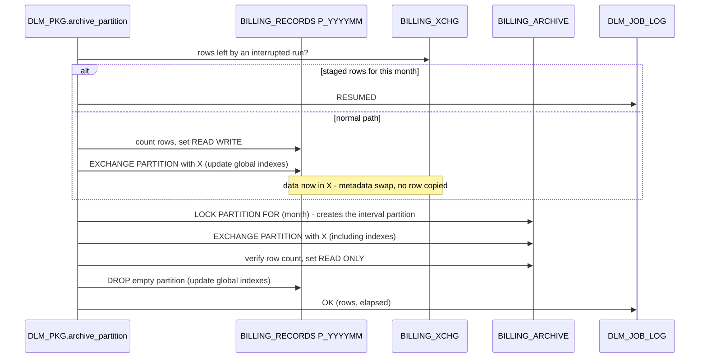
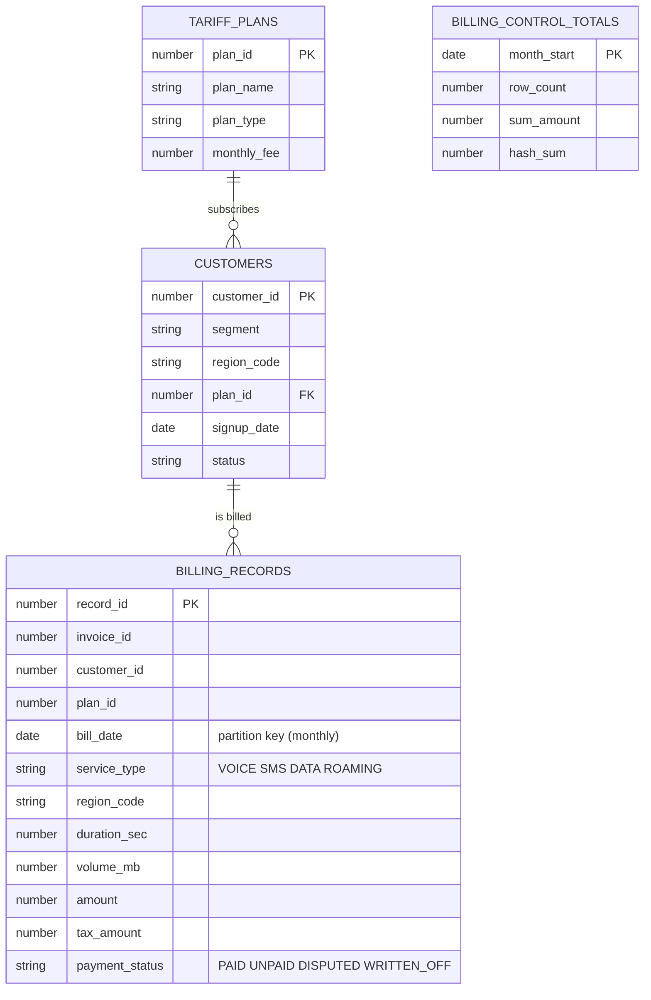

# Architecture

## 1. Overall system architecture

## 2. Storage tiers (data lifecycle)

All thresholds live in `DLM_CONFIG` (`HOT_MONTHS`, `ONLINE_MONTHS`, `RETENTION_MONTHS`).
`MIN_RETENTION_MONTHS` is a safety floor: no purge below the legal retention, whatever
parameter is passed.

## 3. Archive sequence (zero-copy, resumable)

If the job dies between the two exchanges, no row is lost: the month waits in
`BILLING_XCHG`, `validate_integrity` reports the month as missing, and the next run
(`archive_partition` or `run_lifecycle`) resumes at step 2 (tested in T12-T17).
A month that is not warm yet is warmed first, and months inside the 36-month online window
are refused, so the archive is always compressed and in `TELCO_ARCH`.

**Integrity model.** Control totals (row count, amount total, sum of a fingerprint of every
column) are captured at load time and re-captured when a month is frozen (WARM, read-only).
From then on the month cannot change, so every move, exchange and purge is validated
against them. HOT months are live - the application writes to them - and are not validated
by the monthly job.

## 4. Logical data model

`BILLING_RECORDS`, `BILLING_ARCHIVE`, `BILLING_XCHG`, `BILLING_ARCHIVE_BASE` and
`BILLING_LOAD_STAGE` are created from `BILLING_RECORDS_BASE` with `CTAS ... WHERE 1=0`, so all
share exactly the same columns.
There is no foreign key from the fact table to `CUSTOMERS`: as in most billing / data
warehouse designs, referential integrity is guaranteed by the loading process, and a
FK would block partition exchange and slow bulk loads.

## 5. Indexing strategy

| Design | Index | Type | Why |
|---|---|---|---|
| Baseline | `record_id` | PK, B-tree | OLTP lookup |
| Baseline | `(customer_id, bill_date)` | B-tree | customer history |
| Baseline | `bill_date` | B-tree | date-range reports |
| Partitioned | `record_id` | PK, **global** B-tree | single probe for any online month (Q5); archived rows have no `record_id` index (lookups there scan the archive) |
| Partitioned | `(customer_id, bill_date)` | **local** B-tree | one small segment per month; moved, exchanged and dropped with its partition |
| Partitioned | *(none on bill_date)* | - | replaced by partition pruning |
| Partitioned archive | `(customer_id, bill_date)` | **local** B-tree | swapped in by `EXCHANGE ... INCLUDING INDEXES` |
| Baseline archive | `(customer_id, bill_date)`, `bill_date` | B-tree | filled row by row by `INSERT ... SELECT` |

Trade-off: the global PK must be maintained (`UPDATE GLOBAL INDEXES`) when a partition is
moved or exchanged out. A **local** unique index must contain the partition key (ORA-14039),
so the alternative is a local PK on `(record_id, bill_date)`: lifecycle operations become
pure metadata, but uniqueness of `record_id` alone is no longer enforced and every lookup by
`record_id` alone probes all partitions.

## 6. Security

| Account | Privileges | Cannot |
|---|---|---|
| `TELCO_OWNER` | owns objects, runs DLM, `SELECT` on a few `V$` views for benchmarking (`V$SQL`/`V$SESSION` are PDB-wide: the owner can read other sessions' SQL text) | - |
| `TELCO_APP` | `INSERT`, `READ` on `BILLING_CURRENT_V` (HOT months only); `READ` on reference data | write outside the HOT window, touch base tables, delete/update history, read archive, change retention, run DLM, DDL, lock reference data |
| `TELCO_ANALYST` | `READ` on `BILLING_ALL` and reference data | modify anything, lock tables (`READ`, not `SELECT`), access base tables, policy or DLM |

- No password in code or in Git: `.env` (mode 600, git-ignored) generated by
  `scripts/init_env.sh`; passwords are sent to SQL*Plus through stdin (not visible in `ps`)
  and `SET VERIFY OFF` hides substitution values.
- SYSDBA tasks use OS authentication inside the container (no SYS password needed).
- Warm and archived partitions are **read-only**: billing history cannot be altered, even by
  mistake (test T26, ORA-14466).
- **Application write window**: the application writes through `BILLING_CURRENT_V`
  (`WITH CHECK OPTION`, re-created by every lifecycle run, grants kept). A late row dated in
  an archived or purged month, or far in the future, is rejected (ORA-01402, or ORA-14466 when
the target month is already read-only; tests T27, T28, S03, S04, S12, S13).
  Without it, such a row would silently re-create that month's partition online.
  Oracle behaviour found while testing: the rejected insert still creates the empty interval
  partition (partition creation is autonomous); no row enters it, and the next lifecycle run
  drops every empty partition outside the window (tests T29, T31).
- Passwords are only sent in `CREATE USER` / `ALTER USER` statements (not kept in clear text in
  `V$SQL`), never inside PL/SQL blocks whose literals stay readable in the shared pool.
- Every lifecycle action, refusal and error is logged in `DLM_JOB_LOG`.
- Synthetic, anonymised data only (generated with `ORA_HASH`).
- Separate environments: a small *smoke* dataset (`.env.smoke`) for destructive functional and
  security tests, the full dataset for the benchmark and the demo; the tests refuse to run on a
  dataset larger than 2 M rows. Production would add separate databases (dev / test / prod).

### Main security risks and measures

| Risk | Impact | Measure | Residual risk |
|---|---|---|---|
| Credentials leaked (scripts, Git, process list, logs, shared pool) | account takeover | `.env` mode 600 and git-ignored; passwords via stdin; `SET VERIFY OFF`; passwords only in `CREATE/ALTER USER`; tools container receives only the owner password | `.env` readable by the OS user; owner can read PDB-wide `V$SQL` |
| Application or analyst alters or deletes billing history | fraud, loss of evidence | least privilege (no UPDATE/DELETE), read-only frozen partitions, write window view | owner account can still change anything (should be locked in production, DLM run by a scheduler) |
| Purge of data still under legal retention | legal non-compliance | guards in `purge_partition` / `purge_month` + `MIN_RETENTION_MONTHS` floor, refusals logged | owner can change `DLM_CONFIG` (should be audited) |
| Lifecycle job blocked (locks) | maintenance not done, growth | `READ` grants (no LOCK TABLE / FOR UPDATE for read-only accounts), `ddl_lock_timeout` 60 s | the application (INSERT privilege) can still hold locks |
| Silent data loss during archiving | loss of billing data | zero-copy exchange, resumable steps, row counts, control totals, run stops on mismatch (ORA-20040) | totals re-captured at freeze time (by design) |
| Disk exhaustion on the shared laptop | database and host stop | tablespace, UNDO and TEMP caps; host free-space checks | caps total ~22 GB, larger than the free space on this laptop |
