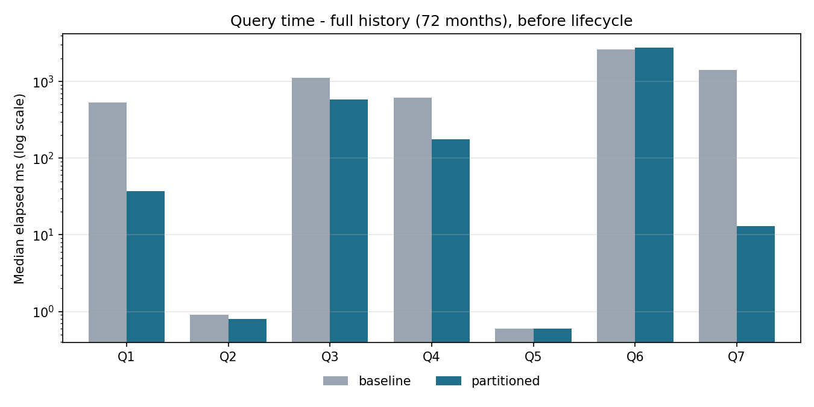
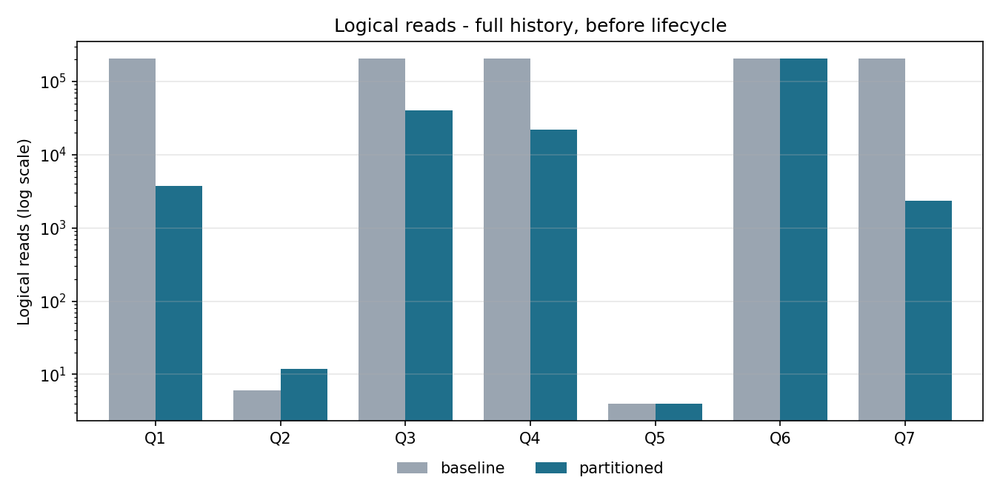
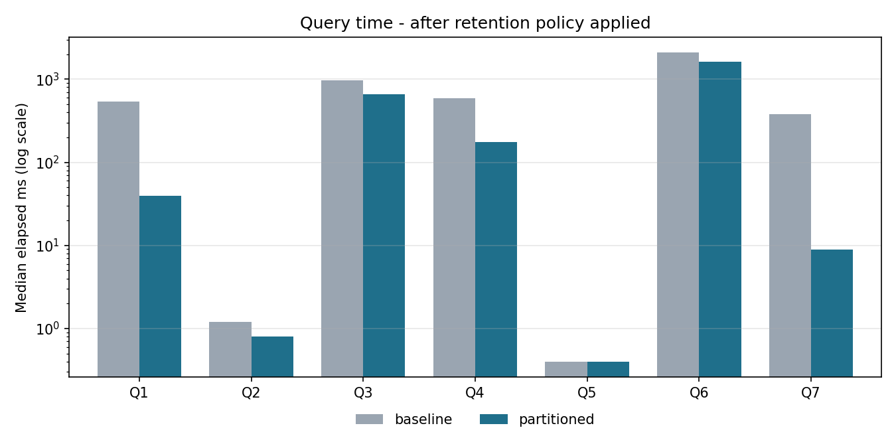
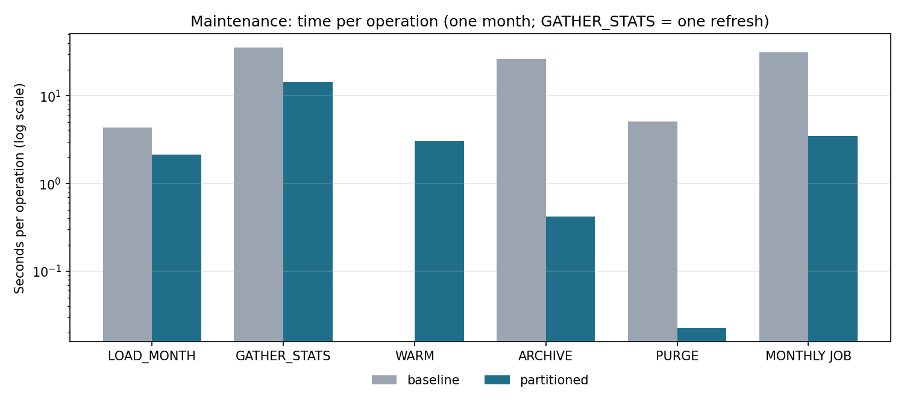
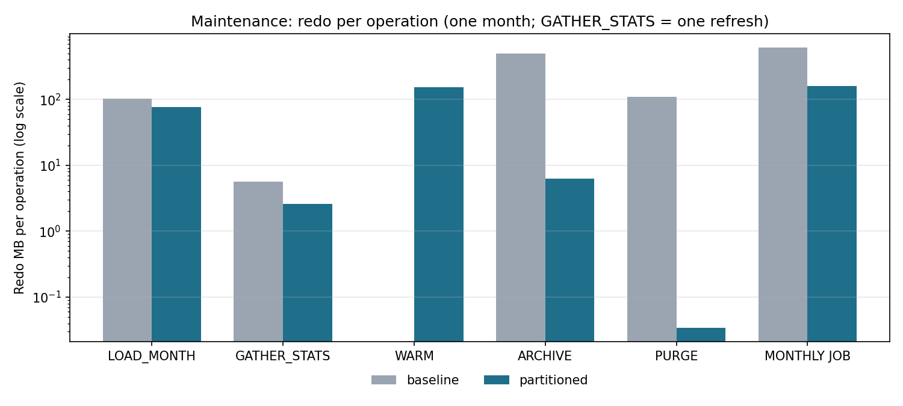
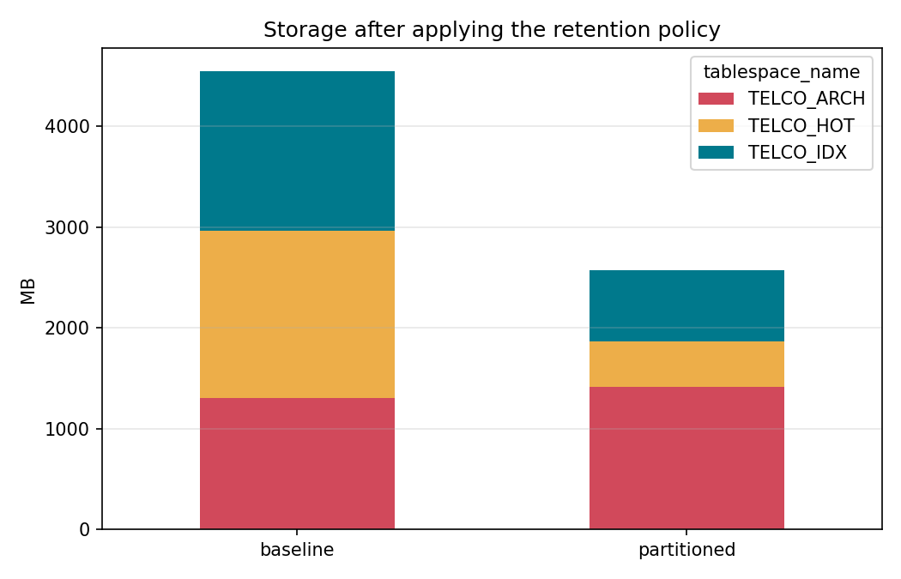

# Benchmark summary

Generated from `results/benchmark_results.json` by `python -m bench.report`.

- Run: 2026-11-09T15:29:31 -> 2026-11-09T15:56:44
- Database: Oracle 19.19.0.0.0 (Docker, laptop) - client python-oracledb 2.5.1 / 3.12.16
- Initial history: 23,760,000 billing records over 72 months
- Each query: 1 warm-up + 5 measured runs, **median** reported.
  LIO = logical reads (blocks read from the buffer cache) - the most stable metric.

## 1. Queries on the full history (before lifecycle)

| Query | Description | Baseline ms | Partitioned ms | Speed-up | Baseline LIO | Partitioned LIO | LIO reduction |
|---|---|---:|---:|---:|---:|---:|---:|
| Q1 | Monthly revenue by service (last closed month) | 535.3 | 37.1 | 14x | 204,092 | 3,746 | 54x |
| Q2 | Customer bill history, last 3 months | 0.9 | 0.8 | 1.1x | 6 | 12 | 0.5x |
| Q3 | Annual revenue by region and service (2025) | 1,108.5 | 580.8 | 1.9x | 204,092 | 39,787 | 5.1x |
| Q4 | Open receivables (unpaid/disputed), last 6 months | 618.5 | 176.9 | 3.5x | 204,092 | 21,829 | 9.3x |
| Q5 | Single billing record lookup by id | 0.6 | 0.6 | 1.0x | 4 | 4 | 1.0x |
| Q6 | Revenue per year over the whole table (no date filter) | 2,623.3 | 2,750.7 | 1.0x | 204,092 | 204,158 | 1.0x |
| Q7 | Disputed bills in an archived month (2022-03) | 1,410.7 | 13.0 | 109x | 204,108 | 2,369 | 86x |

## 2. Queries after applying the retention policy

Baseline = DELETE-based retention on the heap table; partitioned = DLM package.
Q7 reads archived data through the unified views (`BILLING_ALL_BASE` / `BILLING_ALL`).

| Query | Description | Baseline ms | Partitioned ms | Speed-up | Baseline LIO | Partitioned LIO | LIO reduction |
|---|---|---:|---:|---:|---:|---:|---:|
| Q1 | Monthly revenue by service (last closed month) | 534.1 | 39.5 | 14x | 211,566 | 3,746 | 56x |
| Q2 | Customer bill history, last 3 months | 1.2 | 0.8 | 1.5x | 6 | 12 | 0.5x |
| Q3 | Annual revenue by region and service (2025) | 978.9 | 664.3 | 1.5x | 211,566 | 30,338 | 7.0x |
| Q4 | Open receivables (unpaid/disputed), last 6 months | 595.2 | 174.8 | 3.4x | 211,566 | 21,829 | 9.7x |
| Q5 | Single billing record lookup by id | 0.4 | 0.4 | 1.0x | 4 | 4 | 1.0x |
| Q6 | Revenue per year over the whole table (no date filter) | 2,089.7 | 1,636.2 | 1.3x | 211,566 | 103,677 | 2.0x |
| Q7 | Disputed bills in an archived month (2022-03) | 383.0 | 8.9 | 43x | 163,098 | 1,690 | 97x |

## 3. Maintenance operations

| Operation | Design | # | Total s | Avg s / op | Redo MB | Undo MB |
|---|---|---:|---:|---:|---:|---:|
| ARCHIVE | baseline | 36 | 942.0 | 26.17 | 17,956.0 | 7,078.6 |
| ARCHIVE | partitioned | 36 | 15.2 | 0.42 | 227.6 | 189.6 |
| GATHER_STATS | baseline | 1 | 35.4 | 35.44 | 5.7 | 0.3 |
| GATHER_STATS | partitioned | 1 | 14.4 | 14.44 | 2.6 | 0.9 |
| GATHER_STATS_FIRST | baseline | 1 | 32.2 | 32.21 | 5.6 | 0.3 |
| GATHER_STATS_FIRST | partitioned | 1 | 75.3 | 75.27 | 94.3 | 34.4 |
| LOAD_MONTH | baseline | 2 | 8.7 | 4.36 | 203.8 | 88.6 |
| LOAD_MONTH | partitioned | 2 | 4.3 | 2.13 | 152.1 | 67.2 |
| PURGE | baseline | 12 | 61.7 | 5.14 | 1,320.2 | 701.3 |
| PURGE | partitioned | 12 | 0.3 | 0.02 | 0.4 | 0.1 |
| STATS_AFTER_LIFECYCLE | baseline | 2 | 36.7 | 18.36 | 15.4 | 0.5 |
| STATS_AFTER_LIFECYCLE | partitioned | 2 | 43.0 | 21.49 | 31.0 | 10.5 |
| WARM | partitioned | 60 | 183.9 | 3.06 | 9,174.7 | 3,477.0 |

- `LOAD_MONTH`: direct-path load of one new month (2026-11 and 2026-12, ~429,000 rows each).
- `GATHER_STATS_FIRST`: first statistics refresh after the migration (one-time cost while
  incremental synopses settle). `GATHER_STATS`: routine refresh after the next monthly load.
- `PURGE` / `ARCHIVE` / `WARM`: one operation = one month. The partitioned ARCHIVE
  (exchange) relies on the month having been compressed by WARM first, so the fair
  steady-state comparison is the whole **monthly job** below.

### Monthly job (steady state: one month through every step)

| Design | Steps per month | Seconds | Redo MB | Undo MB |
|---|---|---:|---:|---:|
| baseline | ARCHIVE + PURGE | 31.31 | 608.8 | 255.1 |
| partitioned | WARM + ARCHIVE + PURGE | 3.51 | 159.3 | 63.2 |
| **gain** | | **8.9x** | **3.8x** | **4.0x** |

## 4. Storage

Sizes include each table's indexes (baseline archive: 2 indexes; partitioned archive:
1 local index), so differences combine compression and indexing choices.

| Table (incl. its indexes) | Before MB | After MB |
|---|---:|---:|
| BILLING_RECORDS | 3,121 | 1,975 |
| BILLING_RECORDS_BASE | 3,152 | 3,248 |
| BILLING_ARCHIVE | 0 | 587 |
| BILLING_ARCHIVE_BASE | 0 | 1,304 |
| BILLING_XCHG | 0 | 8 |

## 5. Data integrity

| Design | View checked | Months checked | Months in error |
|---|---|---:|---:|
| baseline | BILLING_ALL_BASE | 62 | 0 |
| partitioned | BILLING_ALL | 62 | 0 |
